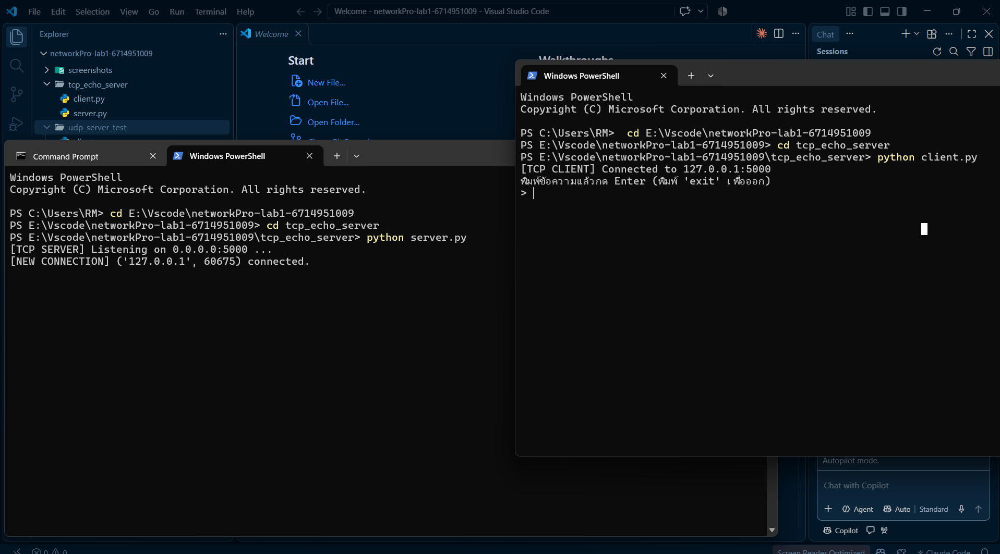
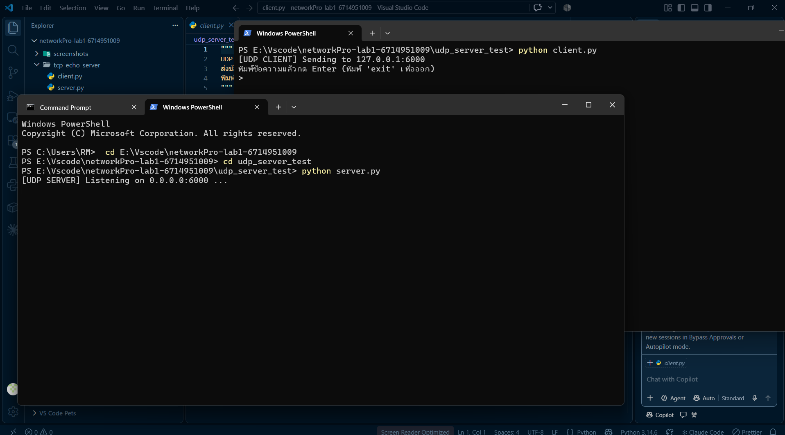

# networkPro-lab1-รหัสนักศึกษา

**ชื่อ-สกุล:** นายวสิษฐ์พล ชวลิต
**รหัสนักศึกษา:** 6714951099
**รายวิชา:** Network Programming — Lab 1

---

## โครงสร้าง Repository

```
networkPro-lab1-รหัสนักศึกษา/
├── README.md
├── tcp_echo_server/
│   ├── server.py
│   └── client.py
├── udp_server_test/
│   ├── server.py
│   └── client.py
└── screenshots/
    ├── tcp_result.png
    └── udp_result.png
```

---

## วิธีดาวน์โหลดและรันโปรแกรม

```bash
git clone https://github.com/6714951009-cell/networkPro-lab1-6714951009.git
cd networkPro-lab1-6714951009
```

### 1. TCP Echo Server

เปิด Terminal ที่ 1 (Server):
```bash
cd tcp_echo_server
python server.py
```

เปิด Terminal ที่ 2 (Client):
```bash
cd tcp_echo_server
python client.py
```

### 2. UDP Server Test

เปิด Terminal ที่ 1 (Server):
```bash
cd udp_server_test
python server.py
```

เปิด Terminal ที่ 2 (Client):
```bash
cd udp_server_test
python client.py
```

---

## ผลการทดสอบ (Screenshots)

### TCP Echo Server — รับส่งข้อความสำเร็จ


### UDP Server Test — รับส่งข้อความสำเร็จ

